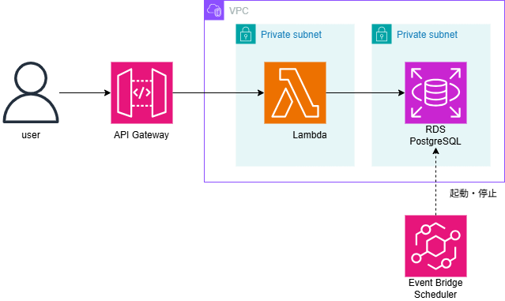

# 学習記録アプリ

## 概要

学習内容や学習時間を記録・管理するためのWebアプリケーションです。

バックエンドにはFastAPI、データベースにはPostgreSQLを使用しています。

個人開発を通して、Webアプリケーションの設計・実装だけでなく、Dockerを利用した開発環境の構築、データベースとの接続、AWSへのデプロイ、クラウド上のアーキテクチャ設計まで一通り経験することを目的として開発しました。

## 主な機能

### ユーザー管理

- ユーザー登録
- ログイン
- JWTを利用した認証
- ユーザー情報の管理

### 学習記録

- 学習記録の登録
- 学習記録の取得
- 学習記録の編集
- 学習記録の削除
- 学習記録の集計

### カテゴリ管理

- カテゴリの登録
- カテゴリの取得
- カテゴリの編集
- カテゴリの削除

## 技術スタック

| 分類 | 技術 |
|---|---|
| Backend | Python / FastAPI |
| ORM | SQLAlchemy |
| Database | PostgreSQL |
| Authentication | JWT |
| Web Server | Uvicorn |
| Container | Docker / Docker Compose |
| Cloud | AWS |
| API | Amazon API Gateway |
| Compute | AWS Lambda |
| Database | Amazon RDS for PostgreSQL |

## アプリケーション構成

バックエンドにはFastAPIを使用しています。

APIは機能ごとに分割し、`APIRouter`を利用して各機能を管理しています。

データベースとの接続にはSQLAlchemyを使用し、PostgreSQLに学習記録やユーザー情報などを保存しています。

認証にはJWTを使用し、ログイン後のユーザー認証を行っています。

開発環境ではDocker Composeを利用して、アプリケーションとPostgreSQLの環境を構築しています。

## AWS構成

AWS上では、Amazon API Gatewayを入口としてAWS Lambdaでアプリケーションの処理を実行し、データベースにはAmazon RDS for PostgreSQLを使用しています。

LambdaではDockerイメージを利用してFastAPIアプリケーションを実行しています。

AWS上でユーザー登録・ログイン・学習記録のCRUD操作が正常に動作することを確認しています。

### AWSアーキテクチャ図

## AWS構成を設計した理由

### API Gateway + Lambda

API Gatewayをアプリケーションへの入口とし、LambdaでFastAPIの処理を実行する構成としています。

個人開発・ポートフォリオ用途であり、常時稼働するサーバーを必要としないため、Lambdaを利用する構成としました。

### RDSをPrivate Subnetに配置

データベースをインターネットから直接アクセスできないPrivate Subnetに配置しています。

セキュリティグループによってデータベースへのアクセスを制限し、外部からの直接アクセスを防ぐ構成としています。

### NAT Gatewayを使用しない理由

今回のLambdaは外部APIやインターネットへの通信を必要とせず、主にRDSへのアクセスを行います。

そのため、Lambdaからインターネットへ通信するためのNAT Gatewayは使用していません。

NAT Gatewayによる追加コストを避け、必要最低限の構成としています。

### RDSをSingle-AZとする理由

本アプリケーションは個人開発・ポートフォリオ用途であり、高可用性よりもコストを優先しています。

そのため、RDSはMulti-AZではなくSingle-AZ構成としています。

### DB Subnet Group

RDSをVPC内で利用するため、DB Subnet Groupを使用しています。

DB Subnet Groupには異なるAZに存在するSubnetを登録しています。

RDS自体はSingle-AZ構成としているため、DB Subnet Groupに複数のSubnetを登録していても、実際のDBインスタンスは1つのAZで稼働します。

## セキュリティ

LambdaとRDSにはそれぞれSecurity Groupを設定しています。

RDSへのインバウンド通信は、LambdaのSecurity GroupからのPostgreSQL通信（TCP 5432）のみ許可する構成としています。

また、RDSをPublic Subnetに配置せず、外部から直接アクセスできない構成としています。

## コスト最適化

本アプリケーションは個人開発・ポートフォリオ用途であるため、必要以上のAWSリソースを使用しないことを重視しています。

主なコスト最適化として、以下を採用しています。

- Lambdaを利用し、常時稼働するEC2を使用しない
- NAT Gatewayを使用しない
- RDSをSingle-AZ構成とする

## 今後の改善

- アプリケーション機能の追加
- CI/CD環境の構築
- Infrastructure as Codeの導入
- AWS上での可用性向上
